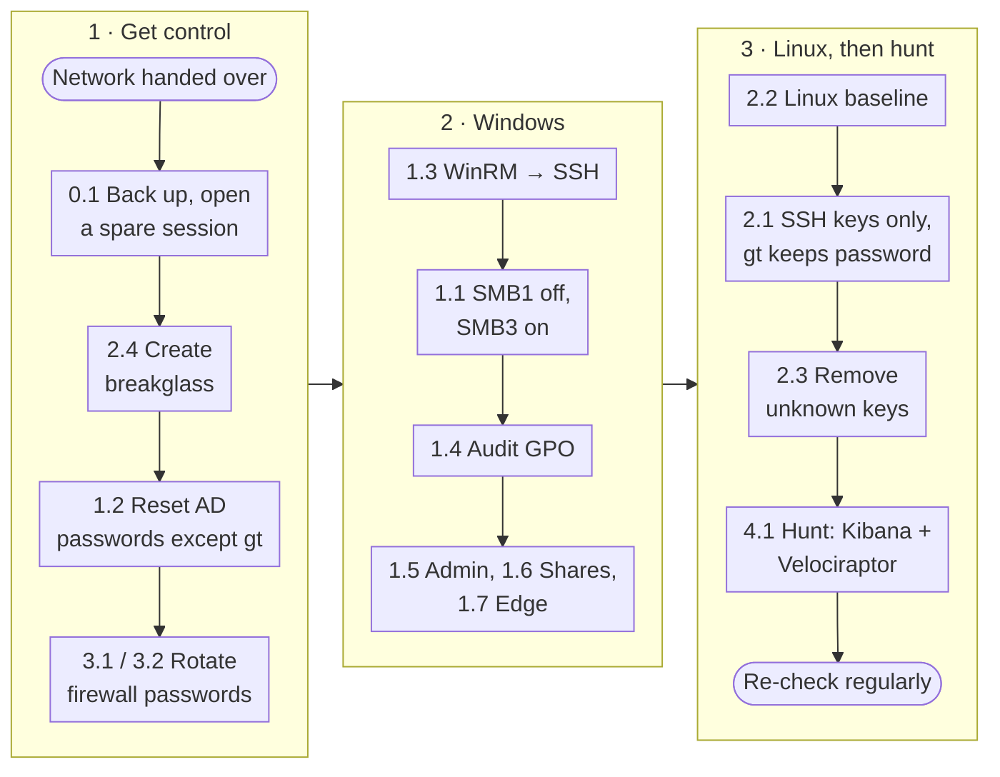

Hardening SOPs for Windows/Active Directory, Linux, pfSense and VyOS, using only built-in tools: PowerShell, Group Policy, bash and the device CLIs. No extra software or repo needed.

How to use it: find the task in the table, open the SOP, and work down its numbered steps. Every SOP has **Check**, **Do**, **Verify** and **Roll back** parts. Read [[0.1 Before any change|0.1]] once before your first change.

## Names used in these SOPs

Replace these with your own before running anything.

| In the SOPs | Means | Example |
|---|---|---|
| `gt` | The one account that **keeps its password** and **keeps password SSH login**. Never reset, disabled or removed. | `gt` |
| `breakglass` | Your emergency admin account: key login, sudo / Domain Admin, password kept offline | `breakglass` |
| `<DC>` | A domain controller | `dc01` |
| `<host>` | The machine you are changing | `10.0.0.20` |
| `example.local` / `DC=example,DC=local` | Your AD domain | |

## Tasks

| Task | Platform | Go to |
|---|---|---|
| Safety steps and protected accounts | All | [[0.1 Before any change\|0.1]] |
| Disable SMB1, enforce SMB3 | Windows, GPO | [[1.1 Disable SMB1 and enforce SMB3\|1.1]] |
| Reset every AD password except `gt` | AD | [[1.2 Mass AD password reset with exceptions\|1.2]] |
| Move remote management from WinRM to SSH (keys only, password for `gt`) | Windows | [[1.3 Move from WinRM to SSH\|1.3]] |
| Turn on audit logging with a GPO | AD | [[1.4 Audit policy GPO\|1.4]] |
| Disable the built-in Administrator | AD | [[1.5 Disable built-in Administrator\|1.5]] |
| Remove Everyone/Guest/Users write on shares | Windows | [[1.6 Lock down shares\|1.6]] |
| Block risky downloads in Edge | Windows, GPO | [[1.7 Block downloads in Edge\|1.7]] |
| Sinkhole a domain in AD DNS | AD | [[1.8 Sinkhole domains in AD DNS\|1.8]] |
| SSH keys only, password for `gt` | Linux | [[2.1 SSH keys only with password exception\|2.1]] |
| Baseline lockdown (sysctl, firewall, services) | Linux | [[2.2 Baseline lockdown\|2.2]] |
| Find and remove unknown SSH keys | Linux | [[2.3 Audit SSH keys\|2.3]] |
| Create a `breakglass` sudo user | Linux | [[2.4 Break-glass sudo user\|2.4]] |
| SMB3 only on Samba | Linux | [[2.5 Samba SMB3 only\|2.5]] |
| pfSense backup, password, keys, blocklist | pfSense | [[3.1 pfSense\|3.1]] |
| VyOS keys, backup, restore | VyOS | [[3.2 VyOS\|3.2]] |
| Hunt for persistence and backdoors (Kibana, Velociraptor) | Windows, Linux | [[4.1 Hunt for persistence\|4.1]] |

## Suggested order on a fresh network

---
Next: [[0.1 Before any change]]
