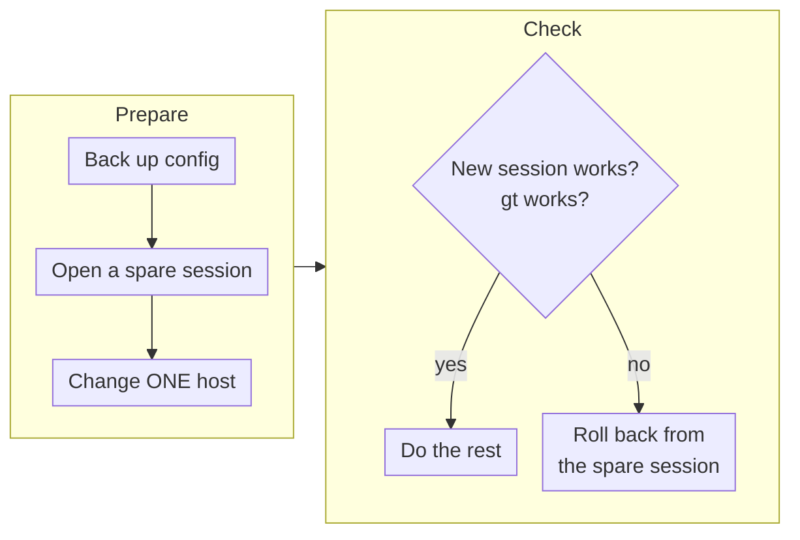

Up: [[0 Start here]]

Do these every time, in this order.



1. **Back up first.**
   - Linux SSH: `cp /etc/ssh/sshd_config /etc/ssh/sshd_config.bak`
   - Windows SSH: `Copy-Item C:\ProgramData\ssh\sshd_config C:\ProgramData\ssh\sshd_config.bak`
   - Group Policy: `Backup-GPO -All -Path C:\GPOBackup`
   - pfSense / VyOS: [[3.1 pfSense|3.1]], [[3.2 VyOS|3.2]]
2. **Keep a spare session open** (SSH, RDP or console) while you change anything to do with logins. Do not close it until step 4 passes.
3. **Change one host first.**
4. **Prove you can still get in** from a new terminal, as the account you will use next time, as `breakglass`, and as `gt`.
5. **Then the rest.**
6. **Write down** what you ran, where and when.

## Protected accounts

Leave these out of every mass change.

| Account                                         | Rule                                                                                       |
| ----------------------------------------------- | ------------------------------------------------------------------------------------------ |
| `gt`                                            | Never reset, disable or remove. Password login stays on for it.                            |
| `krbtgt`                                        | Never in a mass reset. Reset it only as its own procedure: twice, at least 10 hours apart. |
| `Guest`, `DefaultAccount`, `WDAGUtilityAccount` | Built in; leave disabled.                                                                  |
| `breakglass`                                    | Your way back in. Change its password only on purpose, and store the new one offline.      |
| The account you are logged in as                | Resetting it mid-task logs you out of everything.                                          |
| Service accounts (anything with an SPN)         | Changing them stops the service. Rotate one at a time with the owner.                      |

Find service accounts:

```powershell
Get-ADUser -Filter 'ServicePrincipalName -like "*"' -Properties ServicePrincipalName |
  Select-Object SamAccountName, ServicePrincipalName
```

## Create `breakglass` in AD

```powershell
$pw = Read-Host -AsSecureString 'breakglass password'
New-ADUser -Name breakglass -SamAccountName breakglass -AccountPassword $pw -Enabled $true -PasswordNeverExpires $true
Add-ADGroupMember -Identity 'Domain Admins' -Members breakglass
```

Linux: [[2.4 Break-glass sudo user|2.4]].

## If you lock yourself out

- Linux: from the spare session, `cp /etc/ssh/sshd_config.bak /etc/ssh/sshd_config && sshd -t && systemctl restart ssh` (`sshd` on RHEL family).
- Windows SSH: from RDP or the console, `Copy-Item C:\ProgramData\ssh\sshd_config.bak C:\ProgramData\ssh\sshd_config -Force; Restart-Service sshd`.
- Group Policy: `Restore-GPO -Name '<GPO>' -Path C:\GPOBackup`, or unlink it: `Remove-GPLink -Name '<GPO>' -Target '<OU DN>'`.

---
Prev: [[0 Start here]] · Next: [[1.1 Disable SMB1 and enforce SMB3]]
