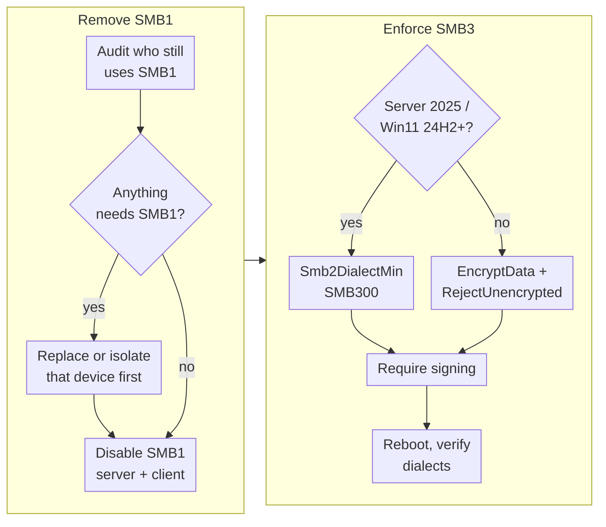

Up: [[0 Start here]] · Safety: [[0.1 Before any change]]

> [!important] SMB2 and SMB3 cannot be switched off separately on Windows
> They are one protocol stack. `Set-SmbServerConfiguration -EnableSMB2Protocol $false` turns off **SMB3 as well**, and the server stops serving files (on a domain controller that includes SYSVOL, so Group Policy breaks). Never run it. To keep clients on SMB3, set a minimum dialect (Server 2025 / Windows 11 24H2 and later) or require encryption, which only SMB3 supports.



## Check

```powershell
Get-SmbServerConfiguration |
  Select-Object EnableSMB1Protocol, EnableSMB2Protocol, EncryptData, RejectUnencryptedAccess, RequireSecuritySignature
Get-WindowsFeature FS-SMB1                                                   # Windows Server
Get-WindowsOptionalFeature -Online -FeatureName SMB1Protocol                 # Windows 10/11
Get-SmbSession | Select-Object ClientComputerName, ClientUserName, Dialect    # who is connected, and how
[Environment]::OSVersion.Version.Build                                       # 26100 or higher = Server 2025 / Win11 24H2+
```

Find anything still using SMB1 before removing it:

```powershell
Set-SmbServerConfiguration -AuditSmb1Access $true -Force
# wait a while, then:
Get-WinEvent -LogName Microsoft-Windows-SMBServer/Audit -MaxEvents 50 |
  Where-Object Id -eq 3000 | Select-Object TimeCreated, Message
```

No event 3000 means nothing is using SMB1.

## Do: one host with PowerShell

1. Disable SMB1:
   ```powershell
   Set-SmbServerConfiguration -EnableSMB1Protocol $false -Force
   Uninstall-WindowsFeature -Name FS-SMB1                                    # Windows Server
   Disable-WindowsOptionalFeature -Online -FeatureName SMB1Protocol -NoRestart   # Windows 10/11
   ```
2. Enforce SMB3. Use **A** on build 26100 or later, otherwise **B**:
   ```powershell
   # A. Minimum dialect
   Set-SmbServerConfiguration -Smb2DialectMin SMB300 -Force
   Set-SmbClientConfiguration -Smb2DialectMin SMB300 -Force

   # B. Require encryption; SMB 2.x clients are refused access to shares
   Set-SmbServerConfiguration -EncryptData $true -RejectUnencryptedAccess $true -Force
   ```
3. Require signing (stops NTLM relay to SMB):
   ```powershell
   Set-SmbServerConfiguration -RequireSecuritySignature $true -EnableSecuritySignature $true -Force
   Set-SmbClientConfiguration -RequireSecuritySignature $true -Force
   ```
4. Reboot when you can, to finish removing the SMB1 driver.

## Do: whole domain with a GPO

Run on a domain controller.

```powershell
Import-Module GroupPolicy
$gpo = 'SMB hardening'
$dn  = (Get-ADDomain).DistinguishedName
New-GPO -Name $gpo -Comment 'SMB1 off, SMB3 encryption, signing required' | Out-Null

$srv = 'HKLM\SYSTEM\CurrentControlSet\Services\LanmanServer\Parameters'
$cli = 'HKLM\SYSTEM\CurrentControlSet\Services\LanmanWorkstation\Parameters'
$set = @{ Name = $gpo; Context = 'Computer'; Action = 'Update'; Type = 'DWord' }

Set-GPPrefRegistryValue @set -Key $srv -ValueName SMB1                     -Value 0
Set-GPPrefRegistryValue @set -Key 'HKLM\SYSTEM\CurrentControlSet\Services\mrxsmb10' -ValueName Start -Value 4
Set-GPPrefRegistryValue @set -Key $srv -ValueName RequireSecuritySignature -Value 1
Set-GPPrefRegistryValue @set -Key $cli -ValueName RequireSecuritySignature -Value 1
Set-GPPrefRegistryValue @set -Key $srv -ValueName EncryptData              -Value 1
Set-GPPrefRegistryValue @set -Key $srv -ValueName RejectUnencryptedAccess  -Value 1

New-GPLink -Name $gpo -Target $dn -LinkEnabled Yes
New-GPLink -Name $gpo -Target "OU=Domain Controllers,$dn" -LinkEnabled Yes
```

Notes:
- Disabling the SMB1 client driver also needs `DependOnService` on `LanmanWorkstation` changed to `Bowser`, `MRxSmb20`, `NSI`. It is simpler to use the **MS Security Guide** templates from the Microsoft Security Compliance Toolkit: Computer Configuration → Policies → Administrative Templates → MS Security Guide → "Configure SMB v1 server" (Disabled) and "Configure SMB v1 client driver" (Enabled, Disable driver).
- On Server 2025 / Windows 11 24H2+ the minimum dialect is a real policy: Computer Configuration → Administrative Templates → Network → Lanman Server → **Mandate the minimum version of SMB**, and the same under Lanman Workstation.
- Registry preferences stay after the GPO is unlinked. Roll back with the commands below.
- Apply now instead of waiting up to 90 minutes: `Invoke-GPUpdate -Computer <host> -Force`, or `gpupdate /force` on the host.

## Verify

```powershell
Get-SmbServerConfiguration | Select-Object EnableSMB1Protocol, EnableSMB2Protocol, EncryptData, RequireSecuritySignature
# Expect: EnableSMB1Protocol False, EnableSMB2Protocol True (this covers SMB2 and 3), EncryptData True
Get-SmbSession | Select-Object ClientComputerName, Dialect   # every Dialect should be 3.x
```

From Linux: `nmap -p445 --script smb-protocols <host>` should list no SMB1 (`NT LM 0.12`). On a domain client, `gpupdate /force` must still finish without SYSVOL errors.

## Roll back

```powershell
Set-SmbServerConfiguration -EncryptData $false -Force
Set-SmbServerConfiguration -Smb2DialectMin None -Force          # if you used option A
Set-SmbClientConfiguration -Smb2DialectMin None -Force
Set-SmbServerConfiguration -RequireSecuritySignature $false -Force
```

Do not turn SMB1 back on as a fix; replace or isolate the old device instead.

Linux file servers: [[2.5 Samba SMB3 only|2.5]].

---
Prev: [[0.1 Before any change]] · Next: [[1.2 Mass AD password reset with exceptions]]
