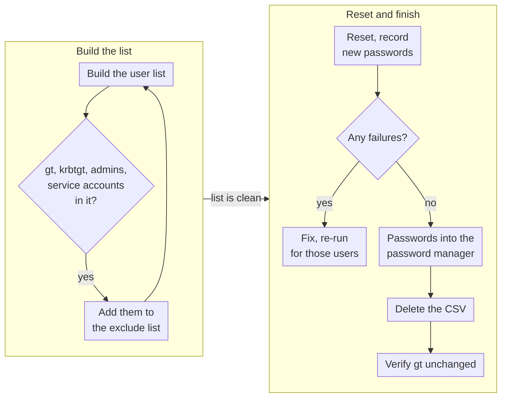

Up: [[0 Start here]] · Safety: [[0.1 Before any change]]

Gives every enabled AD user a new random 20-character password, except `gt` and the other protected accounts in [[0.1 Before any change|0.1]]. Run it on a domain controller as a Domain Admin.



## Check

1. Note `gt`'s current `PasswordLastSet` so you can prove later it did not change:
   ```powershell
   Get-ADUser gt -Properties PasswordLastSet | Select-Object SamAccountName, PasswordLastSet
   ```
2. List service accounts and add any you must not change to `$exclude` below:
   ```powershell
   Get-ADUser -Filter 'ServicePrincipalName -like "*"' | Select-Object SamAccountName
   ```

## Do

1. Set the exclude list and build the target list. **Read the output before going on.**
   ```powershell
   Import-Module ActiveDirectory
   $exclude = @('gt','krbtgt','Guest','Administrator','breakglass', $env:USERNAME)
   # add your admin and service accounts to $exclude here

   $users = Get-ADUser -Filter 'Enabled -eq $true' -Properties ServicePrincipalName |
     Where-Object { $exclude -notcontains $_.SamAccountName -and -not $_.ServicePrincipalName }

   $users | Sort-Object SamAccountName | Select-Object SamAccountName, DistinguishedName | Format-Table -AutoSize
   "Count: $($users.Count)"
   if ($users.SamAccountName -contains 'gt') { throw 'STOP: gt is in the list' }
   ```
   To limit it to one OU, add `-SearchBase 'OU=Staff,DC=example,DC=local'` to `Get-ADUser`.
2. Reset and record:
   ```powershell
   function New-Password([int]$Length = 20) {
     $chars = 'abcdefghijkmnopqrstuvwxyzABCDEFGHJKLMNPQRSTUVWXYZ23456789!#$@'.ToCharArray()
     $bytes = New-Object byte[] $Length
     [Security.Cryptography.RandomNumberGenerator]::Create().GetBytes($bytes)
     -join ($bytes | ForEach-Object { $chars[$_ % $chars.Length] })
   }

   $out = "$env:TEMP\new_passwords.csv"
   'username,password' | Set-Content $out
   foreach ($u in $users) {
     $pw = New-Password
     try {
       Set-ADAccountPassword -Identity $u -Reset -NewPassword (ConvertTo-SecureString $pw -AsPlainText -Force) -ErrorAction Stop
       "$($u.SamAccountName),$pw" | Add-Content $out
     } catch {
       Write-Warning "$($u.SamAccountName): $($_.Exception.Message)"
     }
   }
   "Saved to $out"
   ```
   A warning means that user still has the old password (usually a password-policy refusal or a protected account). Fix it and reset just that user.
3. Move the passwords into your password manager or secrets vault, then delete the file:
   ```powershell
   Remove-Item $out
   ```
4. Optional: make users choose their own at next logon. Skip this for accounts used by services or scripts.
   ```powershell
   $users | Set-ADUser -ChangePasswordAtLogon $true
   ```

## Verify

```powershell
# gt must show the SAME PasswordLastSet as in Check step 1
Get-ADUser gt -Properties PasswordLastSet | Select-Object SamAccountName, PasswordLastSet

# Everyone else: a time from the last few minutes
Get-ADUser -Filter 'Enabled -eq $true' -Properties PasswordLastSet |
  Sort-Object PasswordLastSet | Select-Object SamAccountName, PasswordLastSet
```

Security log on the DC: event **4724** (password reset) for each user, none for `gt`:

```powershell
Get-WinEvent -FilterHashtable @{LogName='Security'; Id=4724; StartTime=(Get-Date).AddHours(-1)} |
  ForEach-Object { $_.Properties[0].Value } | Sort-Object -Unique
```

## Roll back

There is no undo for a password reset. Use the CSV (or your password manager) to give users their new password. If a service broke, set its account's password back to the one the service is configured with, or update the service.

---
Prev: [[1.1 Disable SMB1 and enforce SMB3]] · Next: [[1.3 Move from WinRM to SSH]]
