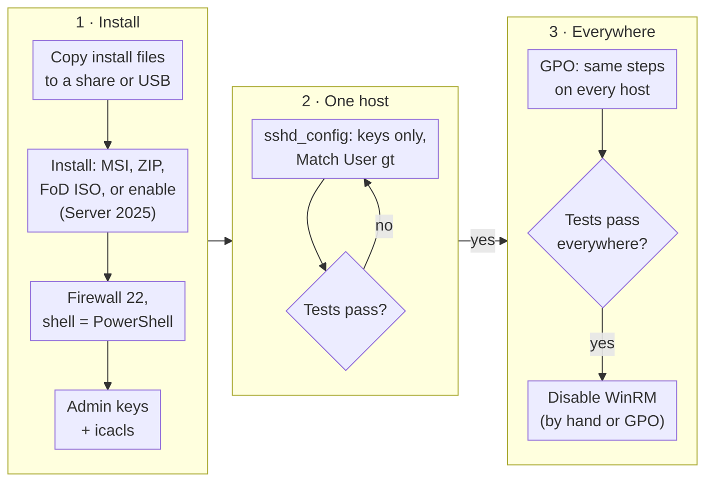

Up: [[0 Start here]] · Safety: [[0.1 Before any change]]

Replaces WinRM with the OpenSSH server. Admins log in with SSH keys only; `gt` can still log in with its password. Installs come from **files you copy in** (MSI, ZIP or the Features on Demand ISO), so the hosts need no internet or Windows Update. Do one host by hand first (parts 1 to 6), then the rest with a GPO (part 7). WinRM is turned off **last**, after SSH is proven (part 8).



## 1. Get the install files

Do this once, on any machine with internet, then copy the files to a share (for example `\\example.local\NETLOGON\openssh\`) or a USB stick.

| Source | Where it comes from | Good for |
|---|---|---|
| **A. MSI** `OpenSSH-Win64-vX.Y.Z.msi` | Win32-OpenSSH releases on the PowerShell GitHub page | Any Windows 10 / Server 2016 or later. Easiest for GPO. |
| **B. ZIP** `OpenSSH-Win64.zip` | Same releases page | When MSI installs are blocked |
| **C. Features on Demand ISO** | Volume Licensing / Visual Studio subscriptions, matching the OS build exactly | The Microsoft-built version (Server 2019/2022, Win10/11) |
| **D. Built in** | Server 2025 already has OpenSSH Server installed, just disabled | Server 2025 |

Check the download's hash against the one on the release page before copying it anywhere: `Get-FileHash .\OpenSSH-Win64-vX.Y.Z.msi`.

Only use one source per host. If `Get-Service sshd` already returns a service, skip the install and go to part 2.

## 2. Install on one host

Elevated PowerShell on the host.

```powershell
# A. MSI (binaries go to C:\Program Files\OpenSSH)
msiexec /i \\example.local\NETLOGON\openssh\OpenSSH-Win64.msi /qn /norestart

# B. ZIP
Expand-Archive \\example.local\NETLOGON\openssh\OpenSSH-Win64.zip -DestinationPath 'C:\Program Files\'
Rename-Item 'C:\Program Files\OpenSSH-Win64' 'OpenSSH'
powershell.exe -ExecutionPolicy Bypass -File 'C:\Program Files\OpenSSH\install-sshd.ps1'

# C. Features on Demand ISO mounted as D: (no Windows Update)
dism /Online /Add-Capability /CapabilityName:OpenSSH.Server~~~~0.0.1.0 /Source:D:\ /LimitAccess

# All, including D (Server 2025):
Set-Service sshd -StartupType Automatic
Start-Service sshd          # first start creates C:\ProgramData\ssh, host keys and a default sshd_config
```

Find where `sshd.exe` lives (it differs between A/B and C/D); later steps use `$sshd`:

```powershell
$sshd = (Get-CimInstance Win32_Service -Filter "Name='sshd'").PathName.Trim('"')
$sshd
```

## 3. Firewall and default shell

```powershell
New-NetFirewallRule -Name OpenSSH-Server-In-TCP -DisplayName 'OpenSSH Server (sshd)' `
  -Enabled True -Direction Inbound -Protocol TCP -LocalPort 22 -Action Allow -ErrorAction SilentlyContinue
# Optional: only from your admin subnet
Set-NetFirewallRule -Name OpenSSH-Server-In-TCP -RemoteAddress 10.0.0.0/24

New-Item HKLM:\SOFTWARE\OpenSSH -Force | Out-Null
New-ItemProperty -Path HKLM:\SOFTWARE\OpenSSH -Name DefaultShell `
  -Value 'C:\Windows\System32\WindowsPowerShell\v1.0\powershell.exe' -PropertyType String -Force
```

## 4. Admin keys

> [!warning] Admins do not use `%USERPROFILE%\.ssh\authorized_keys`
> For any member of Administrators (including Domain Admins on a DC), sshd reads keys **only** from `C:\ProgramData\ssh\administrators_authorized_keys`. A key in the user's profile is silently ignored.

```powershell
$f = 'C:\ProgramData\ssh\administrators_authorized_keys'
Add-Content -Path $f -Value 'ssh-ed25519 AAAA...your-public-key... breakglass'
icacls $f /inheritance:r /grant 'Administrators:F' /grant 'SYSTEM:F'
```

The `icacls` line is required: sshd ignores the file if anyone else can write to it. Non-admin users put keys in `C:\Users\<user>\.ssh\authorized_keys`.

## 5. `sshd_config`: keys only, password for `gt`

Back up the default, then replace `C:\ProgramData\ssh\sshd_config` with this. Keep the same file on the share for part 7.

```
# Managed centrally. Edit the copy on the share, not this one.
Port 22
LogLevel VERBOSE
PubkeyAuthentication yes
PasswordAuthentication no
PermitEmptyPasswords no
AuthorizedKeysFile .ssh/authorized_keys
Subsystem sftp sftp-server.exe

# Match blocks must stay at the end of the file
Match Group administrators
    AuthorizedKeysFile __PROGRAMDATA__/ssh/administrators_authorized_keys

Match User gt
    PasswordAuthentication yes
```

```powershell
Copy-Item C:\ProgramData\ssh\sshd_config C:\ProgramData\ssh\sshd_config.bak
# copy the file above into place, then:
& $sshd -t            # no output = valid
Restart-Service sshd
```

User names are matched in lowercase. If `gt` is a domain account and the plain name does not match in part 6, change the line to `Match User example\gt` (NetBIOS domain name, lowercase).

## 6. Test from another machine, before touching WinRM

```bash
# 1. Admin key login works
ssh -i ~/.ssh/breakglass breakglass@<host> 'whoami'
# 2. gt password login works
ssh -o PubkeyAuthentication=no -o PreferredAuthentications=password gt@<host> 'whoami'
# 3. Any other password login is refused: expect "Permission denied (publickey...)"
ssh -o PubkeyAuthentication=no -o PreferredAuthentications=password someuser@<host>
```

Do not continue until all three pass.

## 7. Roll out to every host with a GPO

### 7.1 Put the files on a share

Every computer account must be able to read it. `NETLOGON` already allows that; a dedicated share needs **Domain Computers: Read** on both share and NTFS permissions.

```
\\example.local\NETLOGON\openssh\
    OpenSSH-Win64.msi                  (or the ZIP)
    sshd_config                        (the file from part 5)
    administrators_authorized_keys     (one public key per line)
    Deploy-OpenSSH.ps1                 (below)
```

Nothing here is secret (public keys and config only), but anyone who can **write** to this folder controls SSH on every host. Only Domain Admins should have write access.

### 7.2 The deployment script

`Deploy-OpenSSH.ps1` runs as SYSTEM. It is safe to run again: it only reinstalls or restarts when something is missing or changed, and it puts the old config back if the new one fails `sshd -t`.

```powershell
$src = '\\example.local\NETLOGON\openssh'
$dst = 'C:\ProgramData\ssh'
Start-Transcript C:\Windows\Temp\Deploy-OpenSSH.log -Append

# 1. Install from the local file if sshd is not there
if (-not (Get-Service sshd -ErrorAction SilentlyContinue)) {
    $msi = Get-ChildItem $src -Filter 'OpenSSH-Win64*.msi' | Select-Object -First 1
    Start-Process msiexec.exe -ArgumentList "/i `"$($msi.FullName)`" /qn /norestart" -Wait
}
Set-Service sshd -StartupType Automatic
if ((Get-Service sshd).Status -ne 'Running') { Start-Service sshd }   # creates host keys on first run

# 2. Default shell
New-Item HKLM:\SOFTWARE\OpenSSH -Force | Out-Null
New-ItemProperty HKLM:\SOFTWARE\OpenSSH -Name DefaultShell -PropertyType String -Force `
  -Value 'C:\Windows\System32\WindowsPowerShell\v1.0\powershell.exe' | Out-Null

# 3. Config and keys, only when they differ from the share
$changed = $false
foreach ($name in 'sshd_config', 'administrators_authorized_keys') {
    $s = Join-Path $src $name; $d = Join-Path $dst $name
    if (-not (Test-Path $d) -or (Get-FileHash $s).Hash -ne (Get-FileHash $d).Hash) {
        if (Test-Path $d) { Copy-Item $d "$d.bak" -Force }
        Copy-Item $s $d -Force
        $changed = $true
    }
}
icacls "$dst\administrators_authorized_keys" /inheritance:r /grant 'Administrators:F' /grant 'SYSTEM:F' | Out-Null

# 4. Validate, then restart; put the old config back if the new one is bad
if ($changed) {
    $sshd = (Get-CimInstance Win32_Service -Filter "Name='sshd'").PathName.Trim('"')
    & $sshd -t
    if ($LASTEXITCODE -ne 0) {
        Write-Warning 'sshd_config invalid, restoring backup'
        Copy-Item "$dst\sshd_config.bak" "$dst\sshd_config" -Force
    }
    Restart-Service sshd
}
Stop-Transcript
```

### 7.3 The GPO

```powershell
$gpo = 'OpenSSH server'
$dn  = (Get-ADDomain).DistinguishedName
New-GPO -Name $gpo -Comment 'Install sshd from share, keys only, password for gt' | Out-Null
# Link to ONE test OU first, then to the rest
New-GPLink -Name $gpo -Target "OU=Test,$dn" -LinkEnabled Yes
```

Edit it in `gpmc.msc`, under Computer Configuration:

1. **Run the script.** Pick one or both:
   - Preferences → Control Panel Settings → Scheduled Tasks → New → **Immediate Task (At least Windows 7)**. Name `Deploy OpenSSH`. Run as `NT AUTHORITY\System`, tick **Run with highest privileges**. Action: program `powershell.exe`, arguments `-NoProfile -ExecutionPolicy Bypass -File \\example.local\NETLOGON\openssh\Deploy-OpenSSH.ps1`. It runs at the next policy refresh, with no reboot. On the Common tab, leave "Apply once and do not reapply" **unticked** so it runs on every refresh and puts back any changes made on the host.
   - Policies → Windows Settings → Scripts (Startup/Shutdown) → Startup → PowerShell Scripts tab → add the same script. This runs at every boot.
2. **Firewall.** Policies → Windows Settings → Security Settings → Windows Defender Firewall with Advanced Security → Inbound Rules → New Rule: Port, TCP 22, Allow, Domain profile. Under Scope, limit remote IPs to your admin subnet.
3. **Service start mode.** Preferences → Control Panel Settings → Services → New → Service. Service name `sshd`, Startup Automatic, Action Start service. (The Security Settings → System Services list only shows sshd if it is installed on the machine you are editing from.)
4. **Optional, Software Installation instead of the script's install step:** Policies → Software Settings → Software installation → New → Package → `\\example.local\NETLOGON\openssh\OpenSSH-Win64.msi` (must be a UNC path) → **Assigned**. Installs at the next reboot.

Apply and check on a test host:

```powershell
gpupdate /force
Get-Content C:\Windows\Temp\Deploy-OpenSSH.log -Tail 20
Get-Service sshd
```

Run the part 6 tests against it, then link the GPO to the other OUs (and `OU=Domain Controllers`).

To change keys or config later, edit the files on the share. Hosts pick them up at the next refresh (about 90 minutes) or at `gpupdate /force`.

## 8. Turn off WinRM

> [!caution] Check first
> Make sure nothing you rely on needs WinRM (Server Manager remote management, monitoring agents, a scored service, configuration tools) and that the part 6 tests pass on **every** host.

One host:

```powershell
Disable-PSRemoting -Force
Get-ChildItem WSMan:\localhost\Listener | Remove-Item -Recurse
Stop-Service WinRM
Set-Service WinRM -StartupType Disabled
Disable-NetFirewallRule -DisplayGroup 'Windows Remote Management'
```

All hosts: a **separate** GPO, `WinRM off`, so you can unlink it on its own if you need WinRM back. Under Computer Configuration → Policies:
- Administrative Templates → Windows Components → Windows Remote Management (WinRM) → WinRM Service → **Allow remote server management through WinRM**: Disabled.
- Windows Settings → Security Settings → System Services → **Windows Remote Management (WS-Management)**: Disabled.
- Windows Defender Firewall with Advanced Security → Inbound Rules → New Rule: Port, TCP 5985, 5986, **Block**.

## Verify

```powershell
Get-Service sshd, WinRM | Select-Object Name, Status, StartType   # sshd Running/Automatic, WinRM Stopped/Disabled
Get-NetTCPConnection -State Listen -LocalPort 22,5985,5986 -ErrorAction SilentlyContinue
gpresult /r /scope computer     # both GPOs listed under Applied Group Policy Objects
```

From another machine: `nc -zv <host> 5985` must fail and `nc -zv <host> 22` must succeed. Repeat the part 6 tests.

## Roll back

- WinRM back: unlink the `WinRM off` GPO, then on the host `Set-Service WinRM -StartupType Automatic; Enable-PSRemoting -Force`.
- Bad SSH config on one host (from RDP or the console): `Copy-Item C:\ProgramData\ssh\sshd_config.bak C:\ProgramData\ssh\sshd_config -Force; Restart-Service sshd`. Fix the copy on the share too, or the next refresh brings the bad one back.
- Remove OpenSSH: `msiexec /x \\example.local\NETLOGON\openssh\OpenSSH-Win64.msi /qn` (MSI), `& 'C:\Program Files\OpenSSH\uninstall-sshd.ps1'` (ZIP), or `dism /Online /Remove-Capability /CapabilityName:OpenSSH.Server~~~~0.0.1.0` (FoD).

---
Prev: [[1.2 Mass AD password reset with exceptions]] · Next: [[1.4 Audit policy GPO]]
