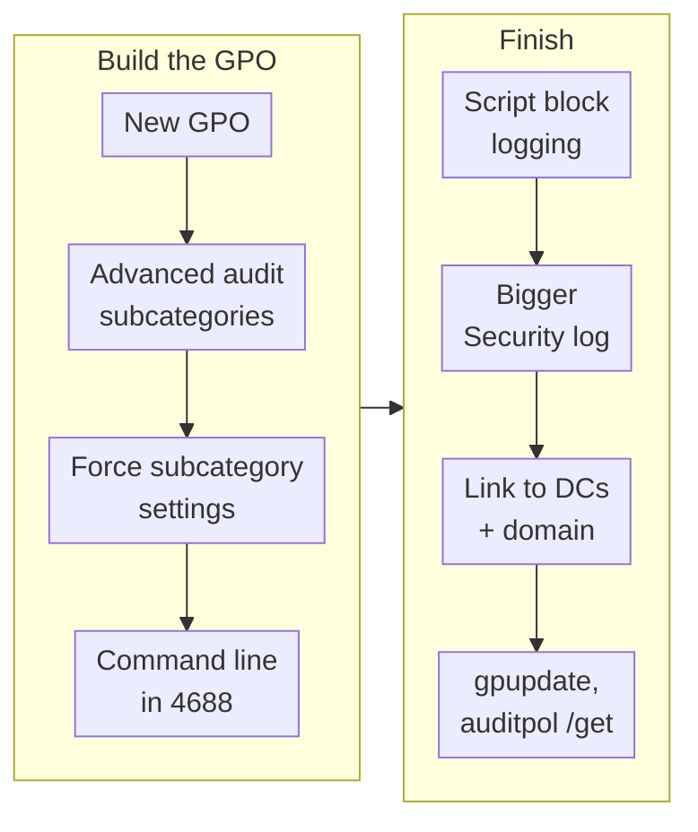

Up: [[0 Start here]] · Safety: [[0.1 Before any change]]

Turns on the Windows security events you need to see logons, account changes, new processes and policy changes. Uses **Advanced Audit Policy**, which replaces the nine old "Audit ..." categories. Do not mix the two.



## Check

```powershell
auditpol /get /category:*
wevtutil gl Security | Select-String maxSize
```

## Do: the GPO

1. Create and link it:
   ```powershell
   $gpo = 'Audit policy'
   $dn  = (Get-ADDomain).DistinguishedName
   New-GPO -Name $gpo | Out-Null
   New-GPLink -Name $gpo -Target "OU=Domain Controllers,$dn" -LinkEnabled Yes
   New-GPLink -Name $gpo -Target $dn -LinkEnabled Yes       # servers and workstations too
   ```
2. Open it in Group Policy Management (`gpmc.msc` → right-click the GPO → Edit) and go to Computer Configuration → Policies → Windows Settings → Security Settings → **Advanced Audit Policy Configuration** → Audit Policies. Set:

   | Category | Subcategory | Setting |
   |---|---|---|
   | Account Logon | Credential Validation | Success, Failure |
   | Account Logon | Kerberos Authentication Service | Success, Failure |
   | Account Logon | Kerberos Service Ticket Operations | Success, Failure |
   | Account Management | User Account Management | Success, Failure |
   | Account Management | Security Group Management | Success |
   | Account Management | Computer Account Management | Success |
   | Detailed Tracking | Process Creation | Success |
   | DS Access | Directory Service Access | Success, Failure |
   | DS Access | Directory Service Changes | Success |
   | Logon/Logoff | Logon | Success, Failure |
   | Logon/Logoff | Logoff | Success |
   | Logon/Logoff | Special Logon | Success |
   | Logon/Logoff | Account Lockout | Failure |
   | Object Access | Other Object Access Events (scheduled tasks) | Success, Failure |
   | Policy Change | Audit Policy Change | Success, Failure |
   | Policy Change | Authentication Policy Change | Success |
   | Privilege Use | Sensitive Privilege Use | Success, Failure |
   | System | Security System Extension | Success |
   | System | Security State Change | Success |
   | System | System Integrity | Success, Failure |

3. In the same GPO: Security Settings → Local Policies → Security Options → **Audit: Force audit policy subcategory settings to override audit policy category settings** = Enabled.
4. The rest can be set from PowerShell:
   ```powershell
   # Include the command line in 4688 process-creation events
   Set-GPRegistryValue -Name $gpo -Key 'HKLM\Software\Microsoft\Windows\CurrentVersion\Policies\System\Audit' `
     -ValueName ProcessCreationIncludeCmdLine_Enabled -Type DWord -Value 1
   # PowerShell script block logging (event 4104)
   Set-GPRegistryValue -Name $gpo -Key 'HKLM\Software\Policies\Microsoft\Windows\PowerShell\ScriptBlockLogging' `
     -ValueName EnableScriptBlockLogging -Type DWord -Value 1
   # Security log 1 GB (value in KB)
   Set-GPRegistryValue -Name $gpo -Key 'HKLM\Software\Policies\Microsoft\Windows\EventLog\Security' `
     -ValueName MaxSize -Type DWord -Value 1048576
   ```

## Do: one host right now, without a GPO

Useful on a standalone server, or while you wait for the GPO.

```powershell
$subs = @{
  'Credential Validation'='SF'; 'Kerberos Authentication Service'='SF'; 'Kerberos Service Ticket Operations'='SF'
  'User Account Management'='SF'; 'Security Group Management'='S'; 'Computer Account Management'='S'
  'Process Creation'='S'; 'Directory Service Access'='SF'; 'Directory Service Changes'='S'
  'Logon'='SF'; 'Logoff'='S'; 'Special Logon'='S'; 'Account Lockout'='F'
  'Other Object Access Events'='SF'; 'Audit Policy Change'='SF'; 'Authentication Policy Change'='S'
  'Sensitive Privilege Use'='SF'; 'Security System Extension'='S'; 'Security State Change'='S'; 'System Integrity'='SF'
}
foreach ($s in $subs.Keys) {
  $ok   = if ($subs[$s] -match 'S') { 'enable' } else { 'disable' }
  $fail = if ($subs[$s] -match 'F') { 'enable' } else { 'disable' }
  auditpol /set /subcategory:"$s" /success:$ok /failure:$fail
}
wevtutil sl Security /ms:1073741824
```

The DS Access subcategories only exist on domain controllers; the command prints an error for them elsewhere, which is fine.

## Verify

```powershell
gpupdate /force
auditpol /get /category:* | Select-String 'Process Creation|Logon|User Account Management'
gpresult /h C:\Windows\Temp\gp.html     # the audit GPO must be listed as applied
# Generate and find a 4688
notepad; Start-Sleep 2; Get-Process notepad | Stop-Process
Get-WinEvent -FilterHashtable @{LogName='Security'; Id=4688} -MaxEvents 5 | Select-Object TimeCreated, Message
```

## Roll back

`Remove-GPLink -Name 'Audit policy' -Target '<OU DN>'`, then `gpupdate /force`. On a host set by hand: `auditpol /clear /y`.

---
Prev: [[1.3 Move from WinRM to SSH]] · Next: [[1.5 Disable built-in Administrator]]
