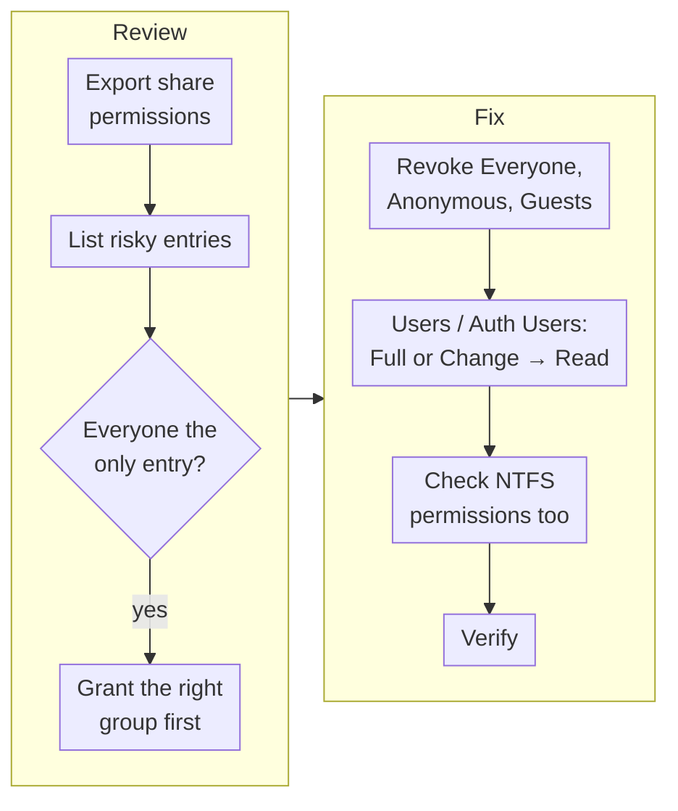

Up: [[0 Start here]] · Safety: [[0.1 Before any change]]

Removes share access for Everyone, Anonymous and Guests, and cuts Users / Authenticated Users down from Full or Change to Read. Admin shares (`C$`, `ADMIN$`, `IPC$`) and the domain shares `SYSVOL` and `NETLOGON` are left alone.



## Check

```powershell
$skip = '^([A-Z]\$|ADMIN\$|IPC\$|PRINT\$|NETLOGON|SYSVOL)$'
$shares = Get-SmbShare | Where-Object Name -notmatch $skip

# Back up first
$shares | ForEach-Object { Get-SmbShareAccess -Name $_.Name } |
  Export-Csv C:\Windows\Temp\share_access_backup.csv -NoTypeInformation

# What is risky
$shares | ForEach-Object { Get-SmbShareAccess -Name $_.Name } |
  Where-Object { $_.AccountName -match 'Everyone|ANONYMOUS LOGON|Guest' -or
                 ($_.AccountName -match 'Authenticated Users|BUILTIN\\Users' -and $_.AccessRight -in 'Full','Change') } |
  Format-Table Name, AccountName, AccessControlType, AccessRight -AutoSize
```

## Do

1. If `Everyone` is the only entry on a share, give the real users access first, or nobody will be able to open it:
   ```powershell
   Grant-SmbShareAccess -Name 'Data' -AccountName 'EXAMPLE\Domain Users' -AccessRight Read -Force
   ```
2. Remove the risky entries:
   ```powershell
   foreach ($s in $shares) {
     foreach ($a in Get-SmbShareAccess -Name $s.Name) {
       if ($a.AccountName -match 'Everyone|ANONYMOUS LOGON|Guest') {
         if ($a.AccessControlType -eq 'Deny') { Unblock-SmbShareAccess -Name $s.Name -AccountName $a.AccountName -Force }
         else { Revoke-SmbShareAccess -Name $s.Name -AccountName $a.AccountName -Force }
       }
       elseif ($a.AccountName -match 'Authenticated Users|BUILTIN\\Users' -and $a.AccessRight -in 'Full','Change') {
         Revoke-SmbShareAccess -Name $s.Name -AccountName $a.AccountName -Force
         Grant-SmbShareAccess  -Name $s.Name -AccountName $a.AccountName -AccessRight Read -Force
       }
     }
   }
   ```
3. Share permissions are only half. Check the folder's NTFS permissions as well:
   ```powershell
   $shares | ForEach-Object { "== $($_.Name) $($_.Path)"; icacls $_.Path }
   ```
   Remove `Everyone` write or `(F)` / `(M)` entries for `Users` with `icacls <path> /remove:g Everyone`.
4. Stop anonymous listing of shares, with a GPO: Security Options → **Network access: Do not allow anonymous enumeration of SAM accounts and shares** = Enabled, and **Network access: Shares that can be accessed anonymously** = empty.

## Verify

Run the "What is risky" command from Check again: no rows. From Linux: `smbclient -L //<host> -N` must fail (no anonymous listing).

## Roll back

```powershell
Import-Csv C:\Windows\Temp\share_access_backup.csv | Where-Object AccessControlType -eq 'Allow' |
  ForEach-Object { Grant-SmbShareAccess -Name $_.Name -AccountName $_.AccountName -AccessRight $_.AccessRight -Force }
```

---
Prev: [[1.5 Disable built-in Administrator]] · Next: [[1.7 Block downloads in Edge]]
