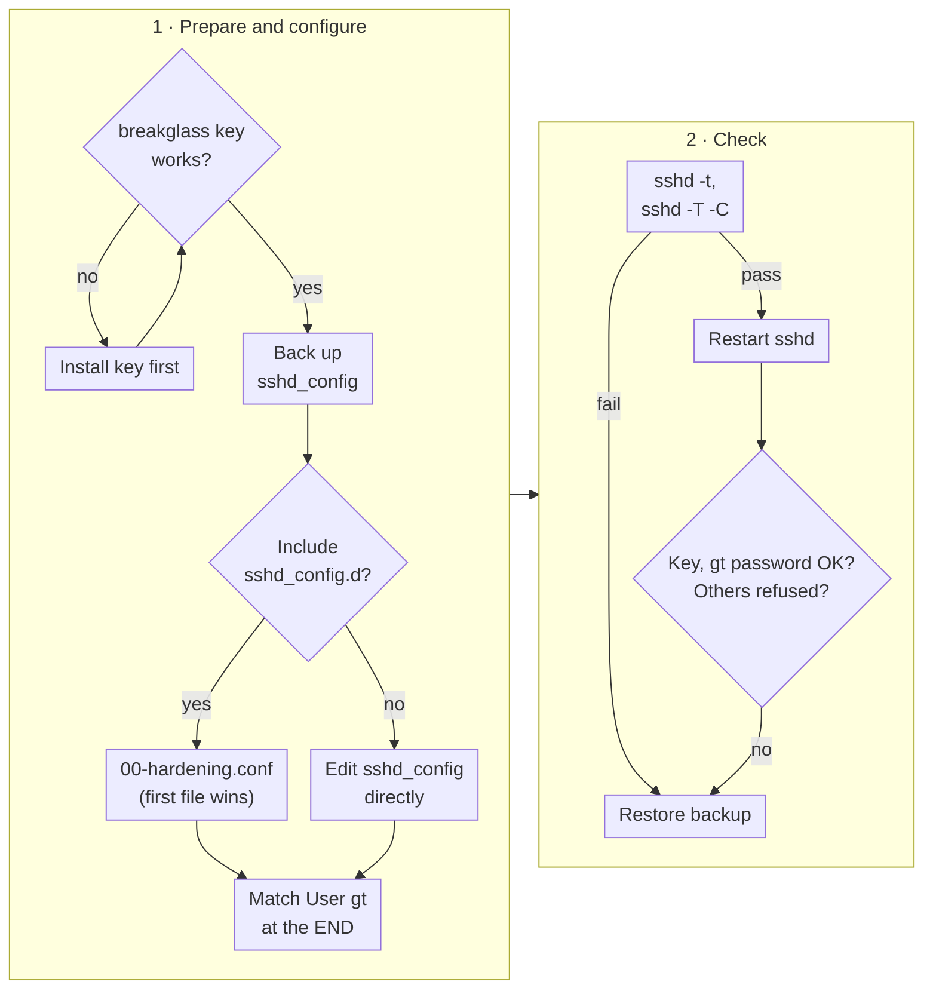

Up: [[0 Start here]] · Safety: [[0.1 Before any change]]

Turns off SSH password login for everyone except `gt`. Admins (`breakglass`) log in with keys. Works on Ubuntu/Debian and RHEL/Rocky/Alma.

> [!important] Run [[2.2 Baseline lockdown|2.2]] first
> Any baseline or vendor script that rewrites `sshd_config` afterwards can switch password login back on. Do this SOP last, then re-check with the Verify section.



## Check

```bash
sshd -T | grep -Ei '^(passwordauthentication|kbdinteractiveauthentication|pubkeyauthentication|permitrootlogin)'
grep -nE '^\s*Include' /etc/ssh/sshd_config
grep -rnEi 'PasswordAuthentication|KbdInteractive|ChallengeResponse' /etc/ssh/sshd_config.d/ 2>/dev/null
passwd -S gt          # second field must be P (has a password), not L (locked) or NP
```

On Ubuntu 22.04 and later, `/etc/ssh/sshd_config.d/50-cloud-init.conf` often contains `PasswordAuthentication yes`. Because the `Include` is at the top of `sshd_config` and sshd keeps the **first** value it reads, that file beats anything you set lower down.

## Do: by hand

1. Give `breakglass` your key (see [[2.4 Break-glass sudo user|2.4]] to create it):
   ```bash
   install -d -m 700 -o breakglass -g breakglass /home/breakglass/.ssh
   echo 'ssh-ed25519 AAAA...your-public-key... breakglass' >> /home/breakglass/.ssh/authorized_keys
   chown breakglass:breakglass /home/breakglass/.ssh/authorized_keys; chmod 600 /home/breakglass/.ssh/authorized_keys
   ```
   From another terminal, check `ssh -i ~/.ssh/breakglass breakglass@<host>` works **before** going on.
2. Back up: `cp -p /etc/ssh/sshd_config /etc/ssh/sshd_config.bak`
3. Set the global options.
   - If `sshd_config` has `Include /etc/ssh/sshd_config.d/*.conf`, create `/etc/ssh/sshd_config.d/00-hardening.conf` (the `00-` makes it load first, so it wins):
     ```
     PubkeyAuthentication yes
     PasswordAuthentication no
     KbdInteractiveAuthentication no
     ChallengeResponseAuthentication no
     PermitEmptyPasswords no
     PermitRootLogin no
     MaxAuthTries 4
     X11Forwarding no
     UsePAM yes
     ```
   - Otherwise put the same lines in `/etc/ssh/sshd_config` above any `Match` line, replacing existing ones.
   - Use `PermitRootLogin prohibit-password` instead of `no` if you still need root key login.
   - Older OpenSSH (before 8.7) prints a deprecation note for `ChallengeResponseAuthentication` or does not know `KbdInteractiveAuthentication`; delete whichever line `sshd -t` complains about.
4. Add the exception at the **very end** of `/etc/ssh/sshd_config`. `Match` applies to everything after it, so nothing else may follow:
   ```
   Match User gt
       PasswordAuthentication yes
       KbdInteractiveAuthentication yes
   ```
5. Check before restarting:
   ```bash
   sshd -t && echo "config OK"
   sshd -T -C user=gt,host=test,addr=192.0.2.1    | grep -i '^passwordauthentication'   # yes
   sshd -T -C user=alice,host=test,addr=192.0.2.1 | grep -i '^passwordauthentication'   # no
   ```
6. Restart: `systemctl restart ssh` (Debian/Ubuntu) or `systemctl restart sshd` (RHEL family).

## Do: script for many hosts

Save as `ssh-keys-only.sh`, edit the three variables, copy to each host and run with `sudo bash ssh-keys-only.sh`. It validates the config and restores the backup if anything fails.

```bash
#!/bin/bash
set -u
EXCEPT_USER="gt"
KEY_USERS=("breakglass")
PUBKEY="ssh-ed25519 AAAA...your-public-key... breakglass"

CFG=/etc/ssh/sshd_config
BAK=/etc/ssh/sshd_config.bak.$(date +%s)
[[ $EUID -eq 0 ]] || { echo "run as root"; exit 1; }
sshd -t || { echo "current config already invalid, stopping"; exit 1; }
cp -p "$CFG" "$BAK"

# Keys
for u in "${KEY_USERS[@]}"; do
  id "$u" &>/dev/null || useradd -m -s /bin/bash "$u"
  h=$(getent passwd "$u" | cut -d: -f6)
  install -d -m 700 -o "$u" -g "$(id -gn "$u")" "$h/.ssh"
  grep -qxF "$PUBKEY" "$h/.ssh/authorized_keys" 2>/dev/null || echo "$PUBKEY" >> "$h/.ssh/authorized_keys"
  chown "$u:$(id -gn "$u")" "$h/.ssh/authorized_keys"; chmod 600 "$h/.ssh/authorized_keys"
done

# Global settings
GLOBAL="PubkeyAuthentication yes
PasswordAuthentication no
KbdInteractiveAuthentication no
PermitEmptyPasswords no
PermitRootLogin no
MaxAuthTries 4
X11Forwarding no
UsePAM yes"
if grep -qE '^\s*Include\s+/etc/ssh/sshd_config.d' "$CFG"; then
  echo "$GLOBAL" > /etc/ssh/sshd_config.d/00-hardening.conf
else
  while read -r key val; do
    sed -i -E "/^\s*#?\s*${key}\s/d" "$CFG"
    sed -i "0,/^Match/s//${key} ${val}\n&/" "$CFG"
    grep -qE "^${key} " "$CFG" || sed -i "1i ${key} ${val}" "$CFG"
  done <<< "$GLOBAL"
fi

# Exception block, always last
sed -i "/# BEGIN password exception/,/# END password exception/d" "$CFG"
cat >> "$CFG" <<EOF

# BEGIN password exception
Match User ${EXCEPT_USER}
    PasswordAuthentication yes
    KbdInteractiveAuthentication yes
# END password exception
EOF

# Validate, prove the exception, restart
ok=1
sshd -t || ok=0
[[ $(sshd -T -C user=${EXCEPT_USER},host=t,addr=192.0.2.1 | awk '/^passwordauthentication/{print $2}') == yes ]] || ok=0
[[ $(sshd -T -C user=nobody-test,host=t,addr=192.0.2.1   | awk '/^passwordauthentication/{print $2}') == no  ]] || ok=0
if [[ $ok -eq 1 ]]; then
  systemctl restart ssh 2>/dev/null || systemctl restart sshd
  echo "OK: keys only, password allowed for ${EXCEPT_USER}"
else
  echo "FAILED: restoring $BAK"
  cp -p "$BAK" "$CFG"; rm -f /etc/ssh/sshd_config.d/00-hardening.conf
  exit 1
fi
```

## Verify

From another machine, keeping the old session open:

```bash
ssh -i ~/.ssh/breakglass breakglass@<host> 'id'                                             # works
ssh -o PubkeyAuthentication=no -o PreferredAuthentications=password gt@<host> 'id'          # works with gt's password
ssh -o PubkeyAuthentication=no -o PreferredAuthentications=password alice@<host>            # Permission denied (publickey)
ssh -o PubkeyAuthentication=no root@<host>                                                   # Permission denied
```

## Roll back

```bash
cp -p /etc/ssh/sshd_config.bak /etc/ssh/sshd_config      # or the timestamped .bak from the script
rm -f /etc/ssh/sshd_config.d/00-hardening.conf
sshd -t && (systemctl restart ssh 2>/dev/null || systemctl restart sshd)
```

---
Prev: [[1.8 Sinkhole domains in AD DNS]] · Next: [[2.2 Baseline lockdown]]
