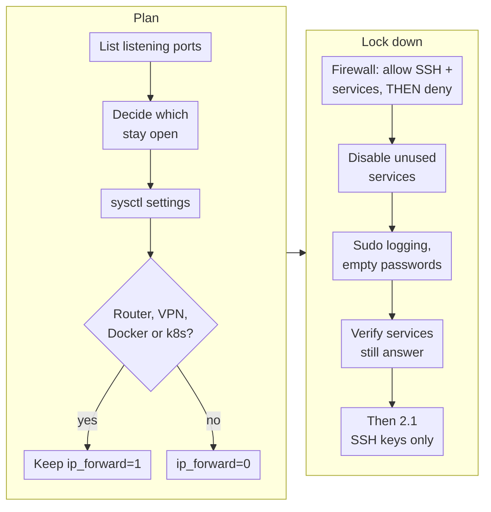

Up: [[0 Start here]] · Safety: [[0.1 Before any change]]

Low-risk hardening for a Linux server: kernel network settings, a host firewall that keeps the server's real services open, unused services off, and sudo logging. SSH login settings are left to [[2.1 SSH keys only with password exception|2.1]], which you run **after** this.



## Check

```bash
ss -tulpn                         # every listening port and the program behind it
systemctl list-units --type=service --state=running
command -v ufw firewall-cmd nft iptables
```

Write down every port a user or another server needs (web 80/443, database, DNS 53, mail 25, and so on). Those must stay open in step 3.

## Do

1. **Back up** what you will touch:
   ```bash
   mkdir -p /root/pre-lockdown && cp -a /etc/sysctl.conf /etc/sysctl.d /etc/sudoers.d /root/pre-lockdown/
   iptables-save > /root/pre-lockdown/iptables.rules 2>/dev/null
   ```
2. **Kernel network settings.** Leave `ip_forward` at 1 on routers, VPN servers, and Docker or Kubernetes hosts, or their networking stops.
   ```bash
   cat > /etc/sysctl.d/99-hardening.conf <<'EOF'
   net.ipv4.ip_forward = 0
   net.ipv4.conf.all.accept_redirects = 0
   net.ipv4.conf.default.accept_redirects = 0
   net.ipv4.conf.all.send_redirects = 0
   net.ipv4.conf.all.accept_source_route = 0
   net.ipv4.conf.all.rp_filter = 1
   net.ipv4.conf.all.log_martians = 1
   net.ipv4.tcp_syncookies = 1
   net.ipv4.icmp_echo_ignore_broadcasts = 1
   kernel.kptr_restrict = 2
   kernel.dmesg_restrict = 1
   fs.suid_dumpable = 0
   EOF
   sysctl --system
   ```
3. **Firewall: allow first, then deny.** Replace the service ports with your list from Check.
   - Ubuntu/Debian (ufw):
     ```bash
     ufw allow 22/tcp
     ufw allow 80/tcp; ufw allow 443/tcp          # your service ports
     ufw default deny incoming
     ufw default allow outgoing
     ufw --force enable
     ```
   - RHEL family (firewalld):
     ```bash
     systemctl enable --now firewalld
     firewall-cmd --permanent --add-service=ssh
     firewall-cmd --permanent --add-service=http --add-service=https   # your services
     firewall-cmd --reload
     ```
   To limit SSH to an admin subnet: `ufw allow from 10.0.0.0/24 to any port 22 proto tcp` (then `ufw delete allow 22/tcp`).
4. **Unused services off.** Only those you have checked are not needed:
   ```bash
   for s in avahi-daemon cups bluetooth rpcbind telnet.socket vsftpd; do
     systemctl disable --now "$s" 2>/dev/null && echo "disabled $s"
   done
   ```
5. **Accounts.**
   ```bash
   awk -F: '($2 == "") {print "EMPTY PASSWORD:", $1}' /etc/shadow
   awk -F: '$3 == 0 && $1 != "root" {print "EXTRA UID 0:", $1}' /etc/passwd
   ```
   Lock any account with an empty password (`passwd -l <user>`), except `gt`, which should have a real password. Investigate any extra UID 0 account ([[4.1 Hunt for persistence|4.1]]).
6. **Sudo logging.**
   ```bash
   cat > /etc/sudoers.d/90-logging <<'EOF'
   Defaults logfile="/var/log/sudo.log"
   Defaults use_pty
   EOF
   chmod 440 /etc/sudoers.d/90-logging
   visudo -c
   ```
7. **Then** do [[2.1 SSH keys only with password exception|2.1]].

## Verify

```bash
sysctl net.ipv4.ip_forward net.ipv4.conf.all.accept_redirects
ufw status verbose 2>/dev/null || firewall-cmd --list-all
ss -tulpn
visudo -c
```

From another machine, check every service from your list still answers (`curl -I http://<host>`, `nc -zv <host> <port>`), and that SSH still works.

## Roll back

```bash
rm /etc/sysctl.d/99-hardening.conf && sysctl --system
ufw disable                      # or: systemctl stop firewalld
rm /etc/sudoers.d/90-logging
systemctl enable --now <service>
```

---
Prev: [[2.1 SSH keys only with password exception]] · Next: [[2.3 Audit SSH keys]]
