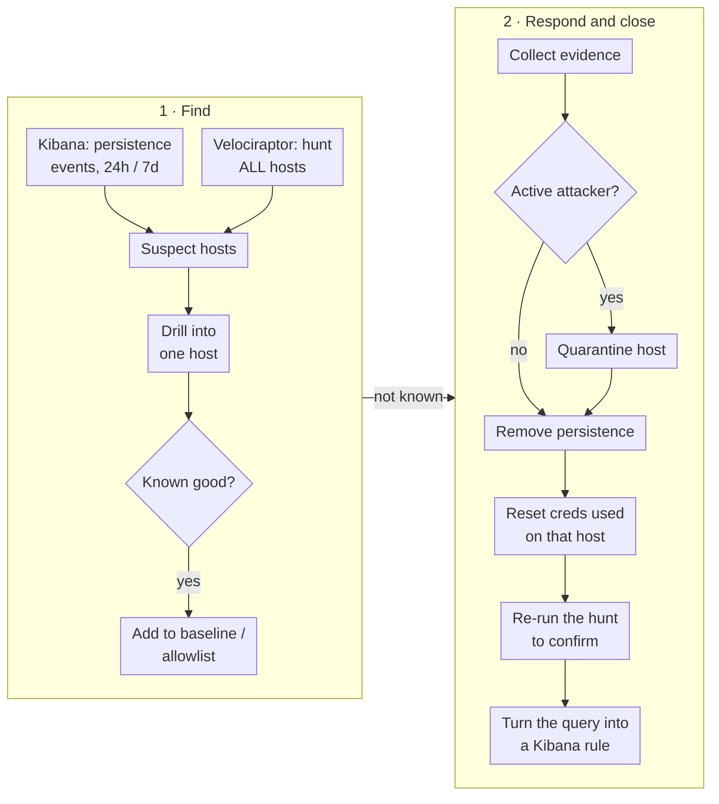

Up: [[0 Start here]] · Safety: [[0.1 Before any change]]

Finds the ways an attacker keeps or regains access, on Windows and Linux. Work in this order:

1. **Kibana** shows what *changed* and when, across every host that ships logs.
2. **Velociraptor** shows what *is there now*, across every host with an agent, including hosts whose logs were cleared.
3. **Local commands** for a host with no agent, or to confirm a hit by hand.

Only remove something once you know what it is, and collect evidence first (part 5).



## What counts as persistence

| | Windows | Linux |
|---|---|---|
| Scheduled jobs | Scheduled tasks | cron, anacron, `at`, systemd timers |
| Services | New services, changed service paths | systemd units, `/etc/init.d`, `rc.local` |
| Autostart | Run/RunOnce keys, Startup folders, Winlogon `Shell`/`Userinit` | `.bashrc`, `.profile`, `/etc/profile.d/` |
| Event triggers | WMI event subscriptions | udev rules, `PROMPT_COMMAND` |
| Code injection | AppInit_DLLs, IFEO debugger keys | `/etc/ld.so.preload`, kernel modules |
| Accounts | New users, group adds, password resets | New users, UID 0 users, `sudoers`, `authorized_keys` |
| Auth | Golden tickets, `SIDHistory`, AdminSDHolder | PAM modules, `sshd_config` changes |
| Remote access | Listening ports, RDP/WinRM/SSH enabled | Listening ports, web shells |

## 1. Kibana

Open **Discover**, pick your logs data view (for example `logs-*`, `winlogbeat-*` or `auditbeat-*`), set the time range to the last 24 hours (then 7 days), and run each query. Add **host.name** as a column. Field names below are ECS, as sent by Elastic Agent, Winlogbeat and Auditbeat. Events marked *Sysmon* need Sysmon installed; events marked *audit* need the audit policy from [[1.4 Audit policy GPO|1.4]].

### Windows

| Looking for | KQL |
|---|---|
| New service | `event.code:("7045" or "4697")` |
| Scheduled task created or changed (*audit*) | `event.code:("4698" or "4702")` |
| Run key or IFEO written (*Sysmon*) | `event.code:"13" and registry.path:(*CurrentVersion\\Run* or *Image?File?Execution?Options*)` |
| WMI subscription (*Sysmon*) | `event.code:("19" or "20" or "21")` |
| WMI subscription (no Sysmon) | `event.provider:"Microsoft-Windows-WMI-Activity" and event.code:"5861"` |
| File dropped in a Startup folder (*Sysmon*) | `event.code:"11" and file.path:*Start?Menu\\Programs\\Startup*` |
| New user / group add | `event.code:("4720" or "4728" or "4732" or "4756")` |
| Password reset (`gt` should never show) | `event.code:"4724"` then `event.code:"4724" and winlog.event_data.TargetUserName:"gt"` |
| Encoded or download-cradle PowerShell | `process.command_line:(*-enc* or *EncodedCommand* or *FromBase64String* or *DownloadString* or *IEX*)` |
| LOLBins fetching files | `process.name:("certutil.exe" or "bitsadmin.exe" or "mshta.exe" or "regsvr32.exe" or "rundll32.exe") and process.command_line:*http*` |
| Logs cleared | `event.code:("1102" or "104")` |
| Remote logons (RDP=10, network=3) | `event.code:"4624" and winlog.event_data.LogonType:("10" or "3") and not user.name:*$` |

### Linux

| Looking for | KQL |
|---|---|
| Changed persistence files (Auditbeat file integrity / Elastic Defend) | `file.path:(/etc/cron* or /var/spool/cron* or /etc/systemd/system* or /lib/systemd/system* or /etc/ld.so.preload or /etc/rc.local or /etc/profile.d* or /etc/sudoers* or /etc/pam.d* or *authorized_keys) and event.type:(creation or change)` |
| Shell rc files changed | `file.name:(".bashrc" or ".profile" or ".bash_profile") and event.type:change` |
| New user / password change | `process.name:("useradd" or "adduser" or "usermod" or "passwd" or "chpasswd")` |
| Crontab edited | `process.name:"crontab"` |
| systemd unit enabled | `process.name:"systemctl" and process.args:("enable" or "daemon-reload")` |
| Kernel module loaded | `process.name:("insmod" or "modprobe")` |
| SSH logins | `event.dataset:"system.auth" and system.auth.ssh.event:"Accepted"` |
| SSH password logins by anyone except `gt` | `system.auth.ssh.event:"Accepted" and system.auth.ssh.method:"password" and not user.name:"gt"` |
| Reverse shells | `process.command_line:(*/dev/tcp/* or *"nc -e"* or *"bash -i"* or *mkfifo*)` |

### Make it permanent

- **Security → Rules → Detection rules** → filter by tag **Tactic: Persistence** → enable the prebuilt rules that match your data sources.
- For any query above that found real activity: **Security → Rules → Create new rule → Custom query**, paste the KQL, run every 5 minutes. Name it after the table row.

## 2. Velociraptor: hunt every host

In the Velociraptor GUI: **Hunt Manager → New Hunt**. Set **Include condition** to the OS (or a label), add the artifacts below, then **Launch**. Results appear under the hunt's **Notebook** tab, with one row per finding per host.

Artifact names change between Velociraptor versions. If one is missing, search **View Artifacts** for the key word.

| Looking for | Windows artifact | Linux artifact |
|---|---|---|
| Autostart (Run keys, Startup folders, services) | `Windows.Sys.StartupItems` | |
| Everything autostart, Sysinternals Autoruns | `Windows.Sysinternals.Autoruns` | |
| Scheduled tasks / cron | `Windows.System.TaskScheduler` | `Linux.Sys.Crontab` |
| Services | `Windows.System.Services` | `Linux.Sys.Services` |
| WMI subscriptions | `Windows.Persistence.PermanentWMIEvents` | |
| IFEO debugger keys | `Windows.Persistence.Debug` | |
| SSH keys | | `Linux.Ssh.AuthorizedKeys` |
| Users | `Windows.Sys.Users` | `Linux.Sys.Users` |
| Running processes | `Windows.System.Pslist` | `Linux.Sys.Pslist` |
| Network connections | `Windows.Network.NetstatEnriched` | `Linux.Network.NetstatEnhanced` |

`Windows.Sysinternals.Autoruns` needs the `autoruns` binary. On a network with no internet, upload `autoruns64.exe` once under **View Artifacts → Windows.Sysinternals.Autoruns → Tools**, and the server hands it to clients.

### Narrow the results in the notebook

Each hunt result has a VQL cell. Edit it to remove the known-good rows. For example, scheduled tasks not signed by Microsoft:

```sql
SELECT Fqdn, Name, Command, Arguments, UserId
FROM source(artifact="Windows.System.TaskScheduler/Analysis")
WHERE NOT Command =~ "(?i)^(C:\\\\Windows\\\\|%windir%|%SystemRoot%)"
```

Services whose binary is outside Windows or Program Files:

```sql
SELECT Fqdn, Name, DisplayName, PathName, UserAccount, Created
FROM source(artifact="Windows.System.Services")
WHERE NOT PathName =~ "(?i)C:\\\\(Windows|Program Files)"
```

Group by value to find the odd one out. Something on only 1 or 2 hosts out of 50 is worth a look:

```sql
SELECT Name, count() AS Hosts, enumerate(items=Fqdn) AS Where
FROM source(artifact="Windows.Sys.StartupItems")
GROUP BY Name
ORDER BY Hosts
```

### Custom artifact: recently changed Linux persistence files

**View Artifacts → Add an Artifact**, paste this, save, then add `Custom.Linux.RecentPersistenceFiles` to a Linux hunt.

```yaml
name: Custom.Linux.RecentPersistenceFiles
description: Persistence locations changed in the last N days
type: CLIENT
parameters:
  - name: Days
    type: int
    default: "7"
sources:
  - precondition: SELECT OS FROM info() WHERE OS = 'linux'
    query: |
      SELECT OSPath, Mtime, Size, Mode.String AS Mode
      FROM glob(globs=[
        '/etc/cron*/**', '/var/spool/cron/**', '/etc/crontab',
        '/etc/systemd/system/**', '/lib/systemd/system/*', '/usr/lib/systemd/system/*',
        '/home/*/.config/systemd/user/**',
        '/etc/ld.so.preload', '/etc/rc.local', '/etc/init.d/*',
        '/etc/profile', '/etc/profile.d/*', '/etc/bash.bashrc',
        '/home/*/.bashrc', '/home/*/.profile', '/root/.bashrc', '/root/.profile',
        '/etc/sudoers', '/etc/sudoers.d/*', '/etc/pam.d/*', '/etc/ssh/sshd_config*',
        '/home/*/.ssh/authorized_keys*', '/root/.ssh/authorized_keys*',
        '/etc/passwd', '/etc/shadow', '/etc/group', '/etc/udev/rules.d/*'])
      WHERE Mtime > timestamp(epoch=now() - Days * 86400)
      ORDER BY Mtime DESC
```

### Keep a baseline

Run the same hunt once the network is clean and note the hunt ID. On later runs, compare by key (task name, service name, file path, key fingerprint) and only look at rows that are new.

## 3. Local checks: Windows

For a host with no agent. Elevated PowerShell. Save everything: `Start-Transcript C:\Windows\Temp\hunt_$(Get-Date -f yyyyMMdd_HHmm).txt`

```powershell
# Scheduled tasks not from Microsoft
Get-ScheduledTask | Where-Object { $_.TaskPath -notlike '\Microsoft\*' -and $_.State -ne 'Disabled' } |
  Select-Object TaskPath, TaskName, @{n='Run';e={"$($_.Actions.Execute) $($_.Actions.Arguments)"}}, @{n='As';e={$_.Principal.UserId}}

# Run keys
'HKLM:\Software\Microsoft\Windows\CurrentVersion\Run','HKLM:\Software\Microsoft\Windows\CurrentVersion\RunOnce',
'HKLM:\Software\WOW6432Node\Microsoft\Windows\CurrentVersion\Run',
'HKCU:\Software\Microsoft\Windows\CurrentVersion\Run','HKCU:\Software\Microsoft\Windows\CurrentVersion\RunOnce' |
  ForEach-Object { Get-ItemProperty $_ -ErrorAction SilentlyContinue | Select-Object * -ExcludeProperty PS* }

# Startup folders
Get-ChildItem "$env:ProgramData\Microsoft\Windows\Start Menu\Programs\StartUp",
  'C:\Users\*\AppData\Roaming\Microsoft\Windows\Start Menu\Programs\Startup' -ErrorAction SilentlyContinue

# Services running from odd places
Get-CimInstance Win32_Service | Where-Object { $_.PathName -and $_.PathName -notmatch 'C:\\Windows\\|C:\\Program Files' } |
  Select-Object Name, State, StartMode, StartName, PathName

# WMI subscriptions (normally only "SCM Event Log Consumer")
Get-CimInstance -Namespace root\subscription -ClassName __EventFilter   | Select-Object Name, Query
Get-CimInstance -Namespace root\subscription -ClassName __EventConsumer | Select-Object Name, CommandLineTemplate, ScriptText
Get-CimInstance -Namespace root\subscription -ClassName __FilterToConsumerBinding | Select-Object Filter, Consumer

# Injection points (AppInit should be empty; Shell = explorer.exe, Userinit = C:\Windows\system32\userinit.exe,)
Get-ItemProperty 'HKLM:\SOFTWARE\Microsoft\Windows NT\CurrentVersion\Windows'  | Select-Object AppInit_DLLs, LoadAppInit_DLLs
Get-ItemProperty 'HKLM:\SOFTWARE\Microsoft\Windows NT\CurrentVersion\Winlogon' | Select-Object Shell, Userinit
Get-ChildItem 'HKLM:\SOFTWARE\Microsoft\Windows NT\CurrentVersion\Image File Execution Options' |
  Get-ItemProperty | Where-Object Debugger | Select-Object PSChildName, Debugger

# Accounts
Get-LocalGroupMember Administrators
'Domain Admins','Enterprise Admins','Schema Admins','Administrators','Account Operators','Backup Operators' |
  ForEach-Object { "== $_"; Get-ADGroupMember $_ -Recursive | Select-Object -ExpandProperty SamAccountName }
Get-ADUser -Filter * -Properties whenCreated | Where-Object whenCreated -gt (Get-Date).AddDays(-7) | Select-Object SamAccountName, whenCreated
Get-ADUser -Filter * -Properties SIDHistory | Where-Object SIDHistory | Select-Object SamAccountName, SIDHistory

# Network and processes
Get-NetTCPConnection -State Listen | Select-Object LocalAddress, LocalPort, @{n='Proc';e={(Get-Process -Id $_.OwningProcess).Path}} | Sort-Object LocalPort
Get-NetTCPConnection -State Established | Where-Object RemoteAddress -notmatch '^(127\.|::1)' |
  Select-Object RemoteAddress, RemotePort, @{n='Proc';e={(Get-Process -Id $_.OwningProcess).Path}}
Get-CimInstance Win32_Process | Where-Object CommandLine -match '-enc |-EncodedCommand|FromBase64String|DownloadString' |
  Select-Object ProcessId, Name, CommandLine

Stop-Transcript
```

## 4. Local checks: Linux

As root. Save everything: `exec > >(tee /root/hunt_$(date +%Y%m%d_%H%M).txt) 2>&1`

```bash
# Cron, at, timers
for u in $(cut -d: -f1 /etc/passwd); do crontab -l -u "$u" 2>/dev/null | sed "s/^/[$u] /"; done
ls -la /etc/cron.* /var/spool/cron/ 2>/dev/null; cat /etc/crontab
atq 2>/dev/null; systemctl list-timers --all

# systemd units and init scripts
systemctl list-unit-files --state=enabled --type=service
find /etc/systemd/system /lib/systemd/system /usr/lib/systemd/system /home/*/.config/systemd -name '*.service' -newermt '-7 days' 2>/dev/null
cat /etc/rc.local 2>/dev/null; ls -la /etc/init.d/

# Shell startup files and preload
ls -la /etc/profile.d/; grep -H . /etc/ld.so.preload 2>/dev/null
grep -HnE 'curl|wget|nc |/dev/tcp|base64|python -c|PROMPT_COMMAND' /etc/profile /etc/bash.bashrc /etc/profile.d/* /root/.bashrc /root/.profile /home/*/.bashrc /home/*/.profile 2>/dev/null

# Accounts and sudo
awk -F: '$3 == 0 {print "UID 0:", $1}' /etc/passwd
awk -F: '$2 == "" {print "EMPTY PASSWORD:", $1}' /etc/shadow
grep -vE '^#|^$' /etc/sudoers /etc/sudoers.d/* 2>/dev/null
ls -la /home/*/.ssh/authorized_keys /root/.ssh/authorized_keys 2>/dev/null

# PAM, SSH, kernel
find /etc/pam.d /lib/security /lib64/security /usr/lib/x86_64-linux-gnu/security -newermt '-7 days' 2>/dev/null
sshd -T | grep -Ei 'passwordauthentication|permitrootlogin|authorizedkeysfile'
lsmod | head -50

# Recently changed files anywhere in /etc, /usr/bin, /tmp
find /etc /usr/bin /usr/sbin /usr/local/bin /tmp /var/tmp /dev/shm -newermt '-2 days' -type f 2>/dev/null | head -100

# Network and processes
ss -tulpn; ss -tnp state established
ps -eo pid,ppid,user,lstart,cmd --sort=start_time | tail -40
ls -la /proc/*/exe 2>/dev/null | grep deleted     # running from a deleted binary
```

## 5. Respond to a confirmed hit

1. **Collect first.** Velociraptor: collect `Windows.KapeFiles.Targets` (Windows) or the Linux hunt artifacts above plus `Custom.Linux.RecentPersistenceFiles` (Linux) from that host, and note file hashes (`Get-FileHash`, `sha256sum`).
2. **Contain if the attacker is active.** Velociraptor: `Windows.Remediation.Quarantine` cuts the host off from everything except the Velociraptor server. Linux: block it at the firewall or run the steps in [[2.2 Baseline lockdown|2.2]].
3. **Remove.** Windows:
   ```powershell
   Unregister-ScheduledTask -TaskName '<name>' -Confirm:$false
   Remove-ItemProperty 'HKLM:\Software\Microsoft\Windows\CurrentVersion\Run' -Name '<name>'
   Stop-Service '<svc>' -Force; sc.exe delete '<svc>'
   Get-CimInstance -Namespace root\subscription -ClassName __FilterToConsumerBinding | Where-Object { "$($_.Filter)" -match '<name>' } | Remove-CimInstance
   Get-CimInstance -Namespace root\subscription -ClassName __EventFilter -Filter "Name='<name>'" | Remove-CimInstance
   Get-CimInstance -Namespace root\subscription -ClassName CommandLineEventConsumer -Filter "Name='<name>'" | Remove-CimInstance
   Stop-Process -Id <pid> -Force
   Disable-ADAccount <user>
   ```
   Linux:
   ```bash
   crontab -r -u <user>                       # or edit out the one line: crontab -e -u <user>
   systemctl disable --now <unit>; rm /etc/systemd/system/<unit>; systemctl daemon-reload
   : > /etc/ld.so.preload
   usermod -L -e 1 <user>                     # lock an account you did not create
   kill -9 <pid>
   ```
   Remove SSH keys with [[2.3 Audit SSH keys|2.3]].
4. **Reset credentials** that were used on that host ([[1.2 Mass AD password reset with exceptions|1.2]] for AD), never `gt`.
5. **Re-run the hunt** on all hosts to confirm it is gone and not elsewhere.
6. **Add a Kibana rule** for what you found (part 1, "Make it permanent").

---
Prev: [[3.2 VyOS]] · Next: [[0 Start here]]
